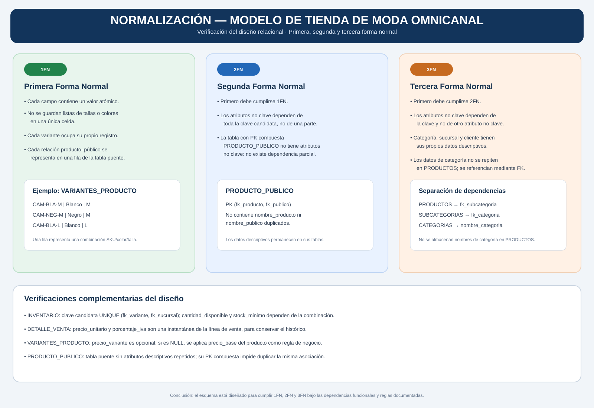

# Normalización — Tienda de Moda Omnicanal

> Análisis del esquema relacional académico inspirado en UNIQLO. Se estudian las formas normales sobre las 15 tablas aprobadas; no se afirma que sea el esquema oficial de UNIQLO.

## Diagrama

[Ver diagrama SVG](Normalizacion-UNIQLO.svg)

## Objetivo
Comprobar que los atributos estén organizados para reducir redundancia, evitar anomalías de inserción/actualización/borrado y mantener dependencias coherentes.

## 1. Primera Forma Normal (1FN)

Criterios aplicados:
- Cada celda contiene un valor atómico.
- No se almacenan listas de colores, tallas, sucursales o públicos dentro de una sola columna.
- Cada variante de producto tiene su propio registro en VARIANTES_PRODUCTO.
- Cada asociación producto–público tiene una fila independiente en PRODUCTO_PUBLICO.
- Cada artículo vendido ocupa una fila en DETALLE_VENTA.

Ejemplo correcto en VARIANTES_PRODUCTO:

| sku | color | talla | fk_producto |
|---|---|---|---:|
| CAM-BLA-M | Blanco | M | 10 |
| CAM-NEG-M | Negro | M | 10 |
| CAM-BLA-L | Blanco | L | 10 |

No se debe guardar `Blanco, Negro, Azul` en una sola celda ni `S, M, L` en un único campo.

## 2. Segunda Forma Normal (2FN)

Criterios aplicados:
- La tabla debe estar en 1FN.
- Todo atributo no clave debe depender de la clave completa, no solo de una parte de una clave compuesta.

La tabla que utiliza una PK compuesta es PRODUCTO_PUBLICO:

`PK (fk_producto, fk_publico)`

No contiene atributos no clave; por tanto, no puede existir dependencia parcial dentro de esta tabla.

En INVENTARIO se define además la clave candidata:

`UNIQUE (fk_variante, fk_sucursal)`

Los atributos `cantidad_disponible` y `stock_minimo` describen el inventario de esa combinación variante–sucursal y dependen de la combinación completa.

Las demás tablas utilizan claves primarias simples; no presentan dependencias parciales respecto de una PK compuesta.

## 3. Tercera Forma Normal (3FN)

Criterios aplicados:
- La tabla debe estar en 2FN.
- Los atributos no clave deben depender de la clave, de toda la clave y de nada más que la clave; no debe haber dependencias transitivas de atributos no clave.

Separaciones relevantes:
- Los nombres y descripciones de categorías se almacenan en CATEGORIAS, no se repiten en PRODUCTOS.
- Los datos de cada subcategoría se almacenan en SUBCATEGORIAS; PRODUCTOS conserva solo `fk_subcategoria`.
- Los datos de sucursal se almacenan en SUCURSALES; VENTAS conserva `fk_sucursal`.
- Los datos personales se almacenan en CLIENTES; VENTAS conserva `fk_cliente`.
- Los nombres de públicos objetivo se almacenan en PUBLICOS_OBJETIVO; PRODUCTO_PUBLICO conserva las claves.
- Los atributos específicos de cada tipo ISA se mantienen en ROPA, CALZADO y COMPLEMENTOS.

## Dependencias funcionales principales

| Tabla | Dependencia funcional principal |
|---|---|
| CATEGORIAS | pk_categoria → nombre_categoria, descripcion |
| SUBCATEGORIAS | pk_subcategoria → nombre_subcategoria, descripcion, fk_categoria |
| PRODUCTOS | pk_producto → nombre_producto, descripcion, precio_base, porcentaje_iva, estado_producto, fk_subcategoria |
| ROPA | pk_producto → material, tipo_prenda |
| CALZADO | pk_producto → material, tipo_calzado |
| COMPLEMENTOS | pk_producto → material, tipo_complemento |
| VARIANTES_PRODUCTO | pk_variante → sku, color, talla, precio_variante, estado_variante, fk_producto |
| PUBLICOS_OBJETIVO | pk_publico → nombre_publico |
| SUCURSALES | pk_sucursal → nombre_sucursal, direccion, ciudad, telefono |
| INVENTARIO | (fk_variante, fk_sucursal) → cantidad_disponible, stock_minimo |
| CLIENTES | pk_cliente → nombre, apellidos, correo_electronico, telefono, fecha_registro |
| VENTAS | pk_venta → fecha_venta, canal_venta, estado_venta, fk_cliente, fk_sucursal |
| DETALLE_VENTA | pk_detalle → fk_venta, fk_variante, cantidad, precio_unitario, porcentaje_iva |
| PAGOS | pk_pago → fk_venta, metodo_pago, fecha_pago, importe, estado_pago |

PRODUCTO_PUBLICO tiene una clave compuesta y no contiene atributos no clave.

## Decisiones que evitan redundancia

### Precio actual frente a precio histórico
- `PRODUCTOS.precio_base` representa el precio general vigente del producto.
- `VARIANTES_PRODUCTO.precio_variante` permite una excepción de precio por variante; si es NULL, se aplica el precio base.
- `DETALLE_VENTA.precio_unitario` guarda el precio realmente aplicado en esa venta.
- `DETALLE_VENTA.porcentaje_iva` guarda el porcentaje aplicado en el momento de la venta.

Así, los cambios futuros de precio o IVA no modifican el histórico de ventas.

### Inventario por sucursal
La cantidad no se almacena en PRODUCTOS ni en VARIANTES_PRODUCTO porque una variante puede tener cantidades distintas en diferentes sucursales. Se mantiene en INVENTARIO, identificado por la combinación variante–sucursal.

## Conclusión y alcance
El diseño separa los datos descriptivos de sus entidades, utiliza tablas puente para relaciones N:M y conserva los valores históricos propios de cada línea de venta. Bajo las dependencias funcionales y reglas indicadas, el esquema está diseñado para cumplir 1FN, 2FN y 3FN.

La comprobación definitiva se realizará después de implementar el esquema y validar las restricciones en MySQL. La normalización no sustituye la validación de reglas de negocio como ISA Total y Disjunta, la existencia de al menos una variante por producto o de al menos una línea por venta.
