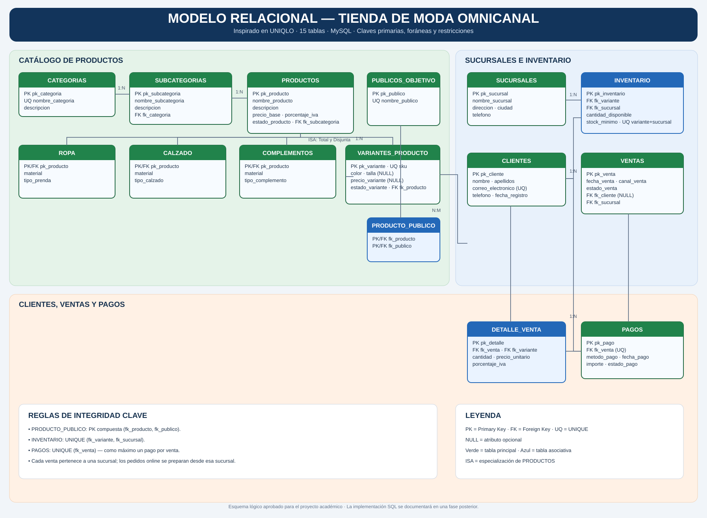

# Modelo Relacional — Tienda de Moda Omnicanal

> Proyecto académico inspirado en el modelo de negocio omnicanal de UNIQLO. No representa el esquema interno ni los sistemas oficiales de UNIQLO.

## Diagrama

[Ver diagrama SVG](Modelo-Relacional-UNIQLO.svg)

## Convenciones
- **PK**: clave primaria.
- **FK**: clave foránea.
- **UQ**: restricción UNIQUE.
- **NULL**: atributo opcional.
- **PK compuesta**: combinación de dos o más columnas que identifica una fila.

## Esquema de las 15 tablas

### 1. CATEGORIAS
- `pk_categoria` INT — PK, AUTO_INCREMENT
- `nombre_categoria` VARCHAR(80) — NOT NULL, UNIQUE
- `descripcion` VARCHAR(255) — NULL

### 2. SUBCATEGORIAS
- `pk_subcategoria` INT — PK, AUTO_INCREMENT
- `nombre_subcategoria` VARCHAR(80) — NOT NULL
- `descripcion` VARCHAR(255) — NULL
- `fk_categoria` INT — FK → CATEGORIAS, NOT NULL
- Regla recomendada: UNIQUE (`fk_categoria`, `nombre_subcategoria`).

### 3. PRODUCTOS
- `pk_producto` INT — PK, AUTO_INCREMENT
- `nombre_producto` VARCHAR(120) — NOT NULL
- `descripcion` VARCHAR(255) — NULL
- `precio_base` DECIMAL(10,2) — NOT NULL, CHECK (> 0)
- `porcentaje_iva` DECIMAL(5,2) — NOT NULL, CHECK (0–100)
- `estado_producto` VARCHAR(20) — NOT NULL
- `fk_subcategoria` INT — FK → SUBCATEGORIAS, NOT NULL

### 4. ROPA
- `pk_producto` INT — PK y FK → PRODUCTOS
- `material` VARCHAR(80) — NULL
- `tipo_prenda` VARCHAR(80) — NULL

### 5. CALZADO
- `pk_producto` INT — PK y FK → PRODUCTOS
- `material` VARCHAR(80) — NULL
- `tipo_calzado` VARCHAR(80) — NULL

### 6. COMPLEMENTOS
- `pk_producto` INT — PK y FK → PRODUCTOS
- `material` VARCHAR(80) — NULL
- `tipo_complemento` VARCHAR(80) — NULL

**ISA:** cada PRODUCTO pertenece exactamente a una de las tres subclases (Total y Disjunta). Esta regla requiere validación adicional; las FK por sí solas no garantizan exclusividad ni participación total.

### 7. VARIANTES_PRODUCTO
- `pk_variante` INT — PK, AUTO_INCREMENT
- `sku` VARCHAR(50) — NOT NULL, UNIQUE
- `color` VARCHAR(50) — NULL
- `talla` VARCHAR(20) — NULL
- `precio_variante` DECIMAL(10,2) — NULL, CHECK (> 0 cuando no sea NULL)
- `estado_variante` VARCHAR(20) — NOT NULL
- `fk_producto` INT — FK → PRODUCTOS, NOT NULL

Cada variante pertenece a un solo producto. El SKU identifica de forma única cada variante. Si `precio_variante` es NULL, se aplica `PRODUCTOS.precio_base`.

### 8. PUBLICOS_OBJETIVO
- `pk_publico` INT — PK, AUTO_INCREMENT
- `nombre_publico` VARCHAR(30) — NOT NULL, UNIQUE
- Valores de referencia: Hombre, Mujer, Unisex, Infantil.

### 9. PRODUCTO_PUBLICO
- `fk_producto` INT — PK compuesta y FK → PRODUCTOS
- `fk_publico` INT — PK compuesta y FK → PUBLICOS_OBJETIVO
- PK (`fk_producto`, `fk_publico`).

Resuelve la relación N:M entre productos y públicos objetivo.

### 10. SUCURSALES
- `pk_sucursal` INT — PK, AUTO_INCREMENT
- `nombre_sucursal` VARCHAR(100) — NOT NULL
- `direccion` VARCHAR(150) — NOT NULL
- `ciudad` VARCHAR(80) — NOT NULL
- `telefono` VARCHAR(20) — NULL

### 11. INVENTARIO
- `pk_inventario` INT — PK, AUTO_INCREMENT
- `fk_variante` INT — FK → VARIANTES_PRODUCTO, NOT NULL
- `fk_sucursal` INT — FK → SUCURSALES, NOT NULL
- `cantidad_disponible` INT — NOT NULL, CHECK (>= 0)
- `stock_minimo` INT — NOT NULL, CHECK (>= 0)
- UNIQUE (`fk_variante`, `fk_sucursal`).

La combinación variante–sucursal es una clave candidata y evita duplicar el inventario de una variante en la misma sucursal.

### 12. CLIENTES
- `pk_cliente` INT — PK, AUTO_INCREMENT
- `nombre` VARCHAR(80) — NOT NULL
- `apellidos` VARCHAR(120) — NOT NULL
- `correo_electronico` VARCHAR(150) — NULL, UNIQUE cuando se informa
- `telefono` VARCHAR(20) — NULL
- `fecha_registro` DATE — NOT NULL

### 13. VENTAS
- `pk_venta` INT — PK, AUTO_INCREMENT
- `fecha_venta` DATETIME — NOT NULL
- `canal_venta` VARCHAR(20) — NOT NULL, CHECK (Online, Tienda)
- `estado_venta` VARCHAR(30) — NOT NULL
- `fk_cliente` INT — FK → CLIENTES, NULL
- `fk_sucursal` INT — FK → SUCURSALES, NOT NULL

Toda venta pertenece a una sucursal. Los pedidos online se preparan y despachan desde esa sucursal. El cliente es opcional para permitir ventas presenciales anónimas.

### 14. DETALLE_VENTA
- `pk_detalle` INT — PK, AUTO_INCREMENT
- `fk_venta` INT — FK → VENTAS, NOT NULL
- `fk_variante` INT — FK → VARIANTES_PRODUCTO, NOT NULL
- `cantidad` INT — NOT NULL, CHECK (> 0)
- `precio_unitario` DECIMAL(10,2) — NOT NULL, CHECK (>= 0)
- `porcentaje_iva` DECIMAL(5,2) — NOT NULL, CHECK (0–100)

El precio unitario y el IVA son valores históricos de la línea de venta.

### 15. PAGOS
- `pk_pago` INT — PK, AUTO_INCREMENT
- `fk_venta` INT — FK → VENTAS, NOT NULL, UNIQUE
- `metodo_pago` VARCHAR(40) — NOT NULL
- `fecha_pago` DATETIME — NOT NULL
- `importe` DECIMAL(10,2) — NOT NULL, CHECK (> 0)
- `estado_pago` VARCHAR(30) — NOT NULL

UNIQUE en `fk_venta` permite como máximo un registro de pago por venta. No obliga a que toda venta tenga ya un pago.

## Relaciones y reglas de integridad
- CATEGORIAS 1:N SUBCATEGORIAS.
- SUBCATEGORIAS 1:N PRODUCTOS.
- PRODUCTOS 1:N VARIANTES_PRODUCTO.
- PRODUCTOS ISA ROPA / CALZADO / COMPLEMENTOS (Total y Disjunta).
- PRODUCTOS N:M PUBLICOS_OBJETIVO, mediante PRODUCTO_PUBLICO.
- VARIANTES_PRODUCTO N:M SUCURSALES, mediante INVENTARIO.
- CLIENTES 1:N VENTAS; fk_cliente es opcional en VENTAS.
- SUCURSALES 1:N VENTAS.
- VENTAS 1:N DETALLE_VENTA.
- VARIANTES_PRODUCTO 1:N DETALLE_VENTA.
- VENTAS 1:0..1 PAGOS.

## Notas de implementación
1. Los tipos y restricciones CHECK se implementarán y probarán en MySQL en una etapa posterior.
2. La participación total y disjunta del ISA, y las reglas de mínimo una variante por producto y mínimo una línea por venta, necesitan controles adicionales (por ejemplo, lógica transaccional o triggers); no quedan garantizadas solo con las FK.
3. El nombre de subcategoría se recomienda único dentro de su categoría.
4. El esquema lógico contiene 15 tablas. La implementación SQL aún no se declara completada.
